<div align="center">

# নকশা (NAKSHA)

### AI-Powered Land Record Integrity Engine for Bangladesh

**Cross-agency cadastral verification · 2D GIS spatial analysis · Cryptographic audit ledger**

[](#)
[](#)
[](#)
[](#)
[](#)
[](#)
[](#)

</div>

---

## 🎯 Problem

Bangladesh's land records are scattered across **5+ agencies** (Sub-Registry, AC Land, DLRS, Union Land Office, DC Office), each using incompatible formats. Officers manually cross-reference paper documents, leading to **fraudulent transfers, Khas encroachment, and double-sale deeds** going undetected.

## 💡 Solution

**NAKSHA** is a zero-integration Chrome Side Panel that overlays existing government portals. It reads the officer's active portal session, verifies identity against a registry, and instantly cross-references cadastral records across all agencies — delivering a **CLEAR / REVIEW / BLOCK** verdict with spatial proof, lineage tracing, and a tamper-proof audit trail.

> **Zero data entry. Zero portal redesign. One click to verify.**

---

## 🏗️ System Architecture

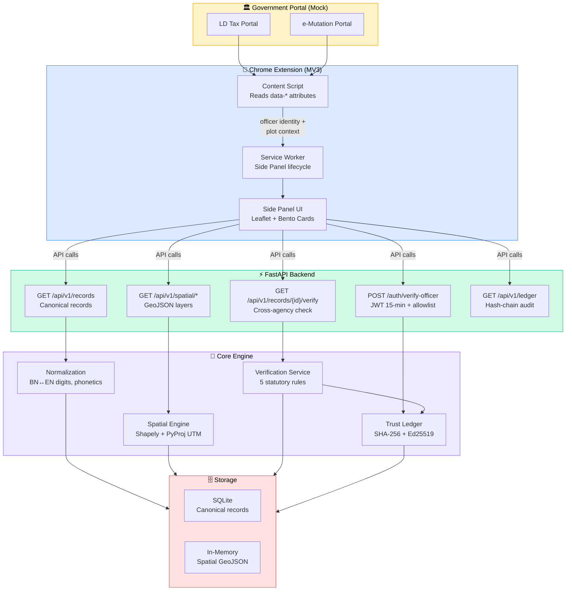

---

## 🖼️ Screenshots

### Portal Integration → Security Gate → Verification Cockpit

<table>
<tr>
<td width="50%">

**Mock Government Portal**
Officer session with floating "যাচাই করুন" pill

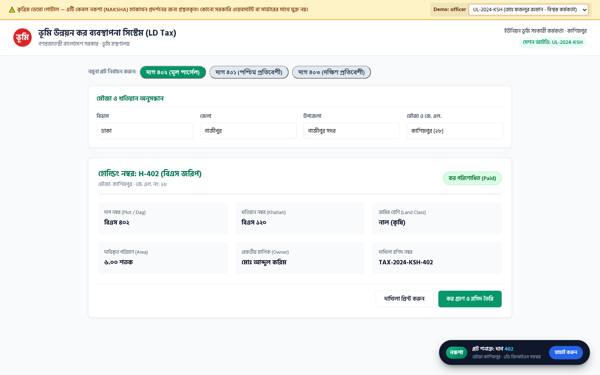

</td>
<td width="50%">

**Security Verification Gate**
Automatic 3-step identity check

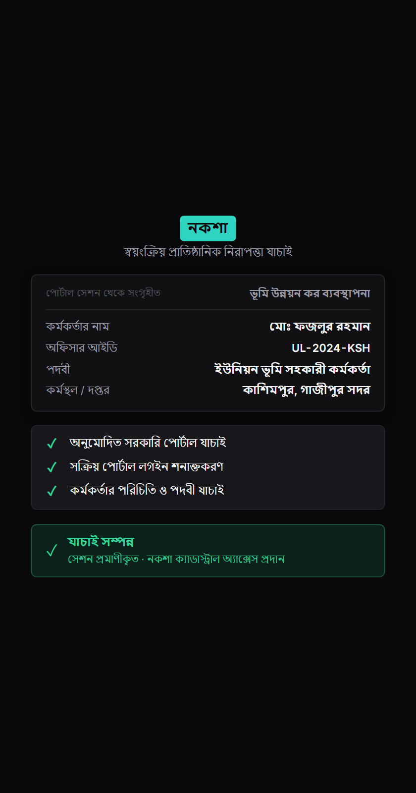

</td>
</tr>
<tr>
<td>

**Cockpit — BLOCK Verdict (EN)**
Khas canal overlap detected on Dag 402

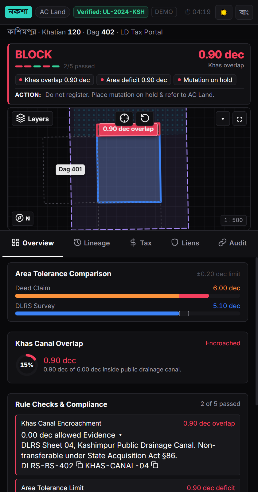

</td>
<td>

**Access Denied — Unlisted Officer**
Unauthorized `EXT-999-HACK` blocked

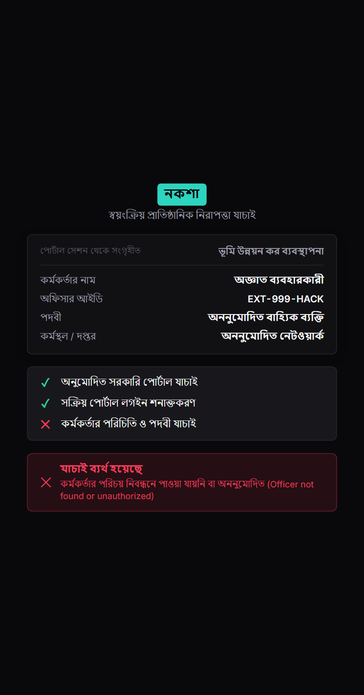

</td>
</tr>
<tr>
<td>

**Multi-Era Layer Popover**
5 cadastral layers — CS·Deed·DLRS·Khas·Conflict

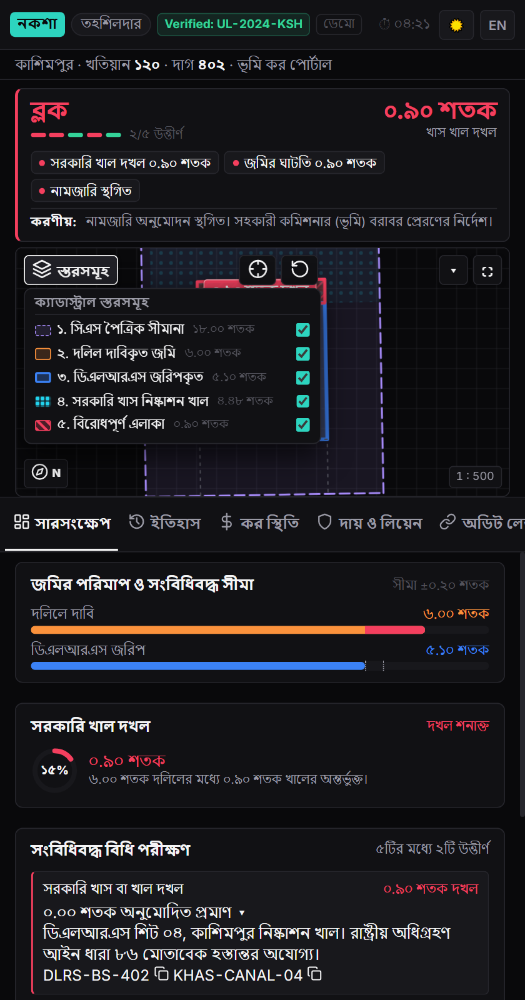

</td>
<td>

**Cryptographic Audit Ledger**
SHA-256 + Ed25519 signed blocks

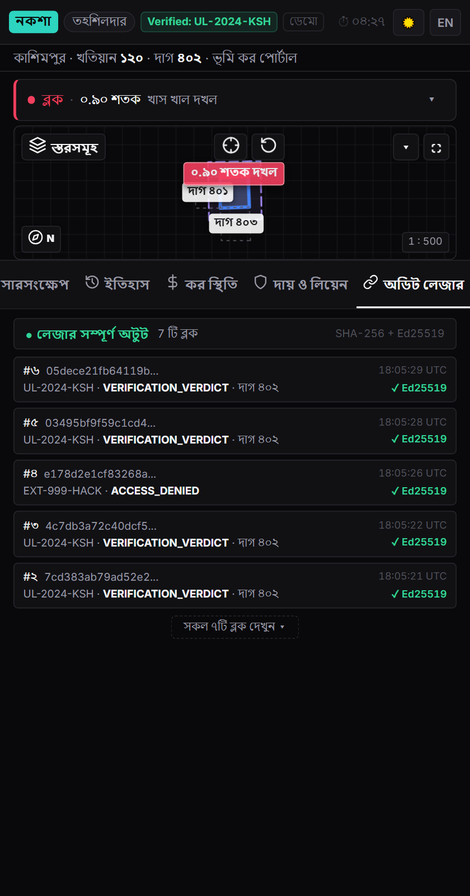

</td>
</tr>
<tr>
<td>

**Lineage History Track**
CS→SA→RS→BS chain + phonetic name match

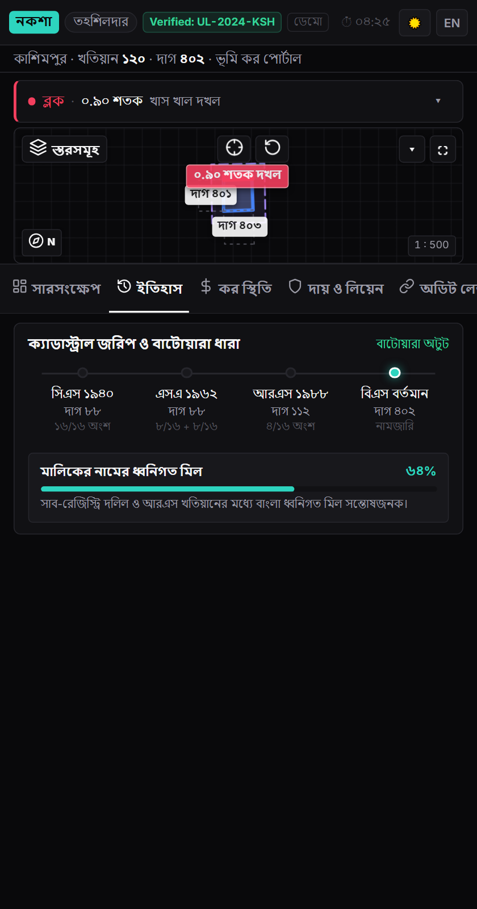

</td>
<td>

**Light Theme / Responsive**
Soft grey theme with complete token coverage

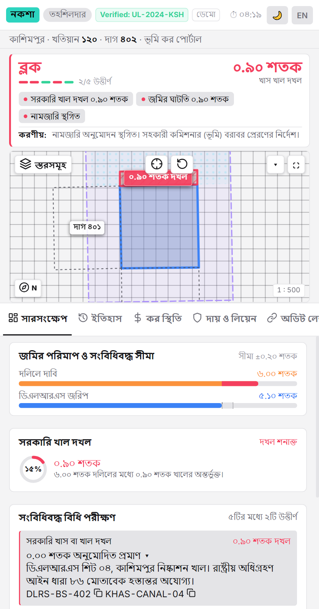

</td>
</tr>
</table>

> 📸 **Full visual catalog** with 24 screenshots across all scenarios, viewports, and themes: [`docs/screenshots/final/INDEX.md`](docs/screenshots/final/INDEX.md)

---

## ✨ Features & Architecture Diagrams

### 1. 🔐 Zero-Login Officer Verification

No credentials entered. Identity is read from the portal's DOM `data-*` attributes.

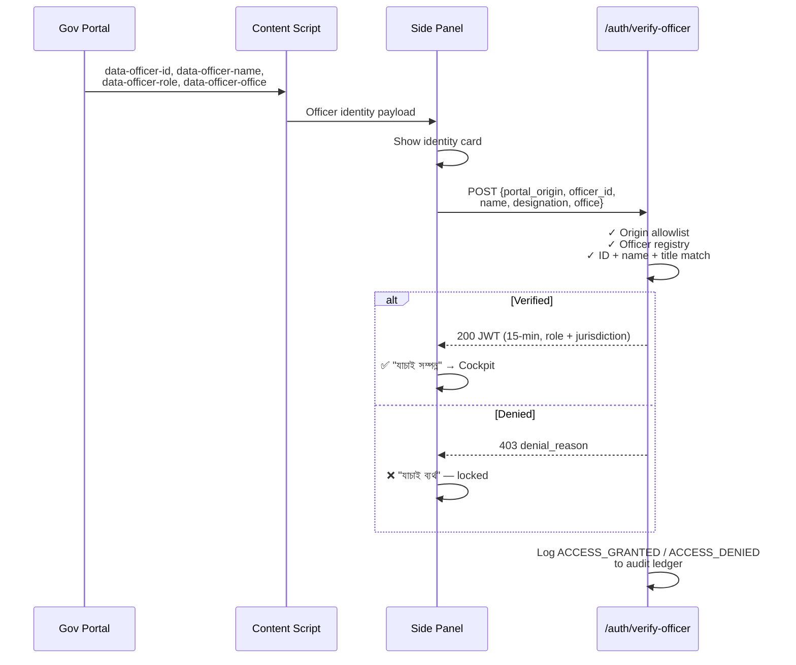

### 2. 🗺️ Multi-Era 2D GIS Spatial Engine

Five toggleable cadastral layers rendered on Leaflet with UTM 46N (`EPSG:32646`) precision.

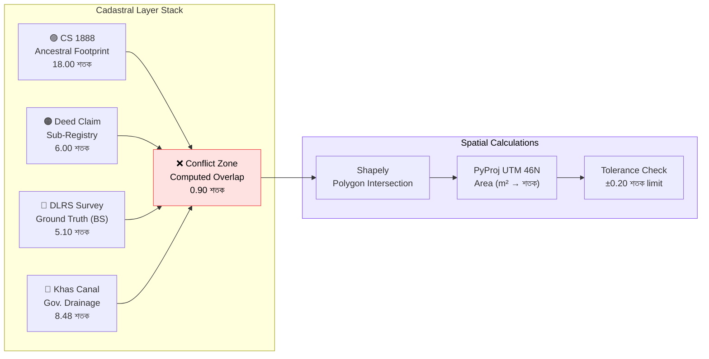

### 3. ⚖️ 5-Rule Statutory Verification Engine

Each plot is evaluated against Bangladesh land law. The worst-case rule determines the verdict.

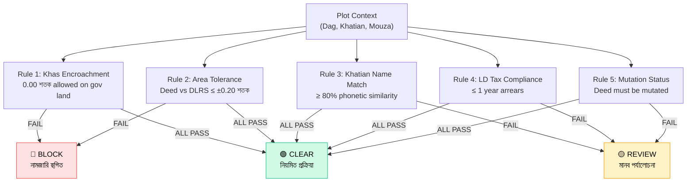

### 4. 🔗 Cryptographic Trust Ledger

Every verification action is recorded in an immutable, hash-chained, digitally signed audit trail.

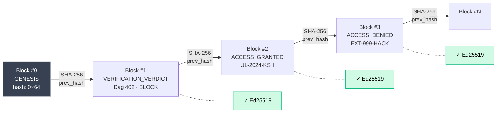

### 5. 🏛️ Cross-Agency Data Flow

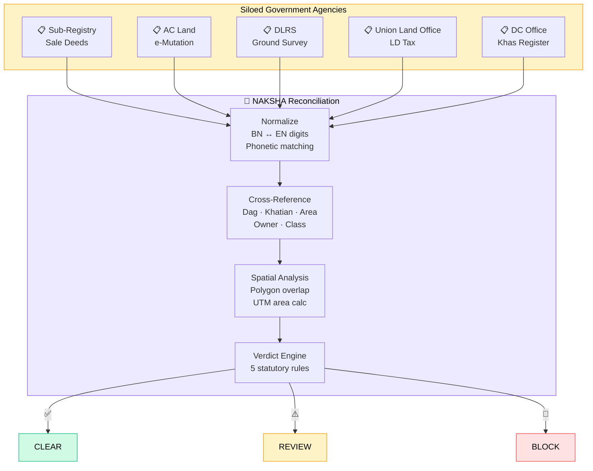

### 6. 📊 Cockpit Tab Architecture

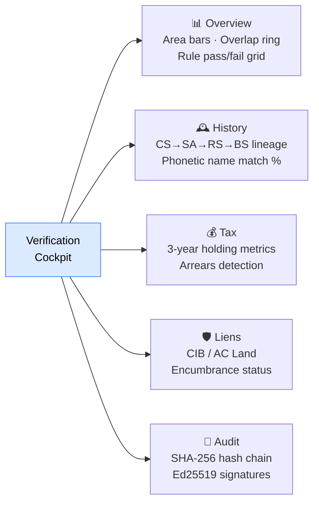

---

## 🛠️ Quick Start

### Prerequisites
- Python 3.11+
- Google Chrome (for extension)

### 1. Setup
```bash
git clone https://github.com/Erebo/naksha.git && cd naksha
python -m venv venv && .\venv\Scripts\Activate.ps1   # Windows
pip install -r requirements.txt
```

### 2. Run Backend
```bash
uvicorn naksha.api.app:app --reload --port 8000
```

### 3. Load Chrome Extension
1. Go to `chrome://extensions/` → Enable **Developer mode**
2. Click **Load unpacked** → Select `extension/` folder
3. Navigate to [http://127.0.0.1:8000/portals/ld-tax](http://127.0.0.1:8000/portals/ld-tax)
4. Click **"যাচাই করুন"** pill → Side Panel opens with verification gate

### 4. Run Tests
```bash
pytest -v    # 67 tests covering all layers
```

### 5. Capture Screenshots
```bash
python scripts/capture_screenshots.py    # 24 automated Playwright captures
```

---

## 📂 Project Structure

```
naksha/
├── extension/                  # Chrome MV3 Extension
│   ├── manifest.json           # Extension manifest
│   ├── background.js           # Service worker (side panel lifecycle)
│   ├── content.js              # Portal DOM reader + floating pill
│   ├── sidepanel.{html,css,js} # Verification cockpit UI
│   ├── tokens.css              # Design tokens (dark/light)
│   └── components/             # VerdictHero, AreaChart, AuditChain,
│                               # LineageTimeline, TaxChart, RuleGrid, i18n
├── naksha/
│   ├── api/
│   │   ├── app.py              # FastAPI factory + CORS + static mounts
│   │   └── routes.py           # 15+ REST endpoints
│   ├── models/
│   │   ├── canonical.py        # Pydantic schemas (LandRecord, GeoJSON, etc.)
│   │   └── enums.py            # AgencyType, Verdict, SurveyEra, LandClass
│   ├── normalization/
│   │   ├── text.py             # BN↔EN digits, phonetic matching
│   │   └── area.py             # Unit conversion (শতক, বিঘা, কাঠা, একর)
│   ├── spatial/
│   │   └── engine.py           # Shapely + PyProj (UTM 46N) calculations
│   ├── services/
│   │   ├── verification.py     # 5-rule statutory engine
│   │   └── ledger.py           # SHA-256 + Ed25519 trust ledger
│   ├── database/               # SQLite + SQLAlchemy persistence
│   ├── data/                   # Synthetic benchmark datasets
│   └── static/                 # Mock portals + standalone side panel
├── tests/                      # 67 tests (pytest)
├── scripts/                    # Playwright screenshot automation
└── docs/screenshots/final/     # 24 captured visual artifacts
```

---

## 🌐 API Reference

| Method | Endpoint | Description |
|:-------|:---------|:------------|
| `GET` | `/health` | Service readiness check |
| `POST` | `/auth/verify-officer` | Officer identity verification → JWT |
| `GET` | `/api/v1/records` | List canonical records (paginated + filtered) |
| `GET` | `/api/v1/records/{id}` | Fetch single record |
| `GET` | `/api/v1/records/{id}/verify` | Cross-agency verification → verdict |
| `GET` | `/api/v1/spatial/parcels` | All parcels as GeoJSON FeatureCollection |
| `GET` | `/api/v1/spatial/parcels/{id}/layers` | 5-layer cadastral stack |
| `GET` | `/api/v1/spatial/parcels/{id}/neighbors` | Neighbor plots + tax status |
| `GET` | `/api/v1/spatial/parcels/{id}/conflicts` | Computed conflict zones |
| `POST` | `/api/v1/spatial/calculate-area` | Polygon → area (m² + শতক) |
| `POST` | `/api/v1/spatial/calculate-overlap` | Two polygons → intersection area |
| `GET` | `/api/v1/ledger` | Full audit chain |
| `GET` | `/api/v1/ledger/verify` | Cryptographic chain integrity check |

---

## 🧪 Test Coverage

| Suite | Tests | Scope |
|:------|:-----:|:------|
| `test_api.py` | 7 | API endpoints, status codes, filters |
| `test_extension.py` | 7 | Manifest, content script, side panel contract |
| `test_frontend.py` | 4 | Portal HTML structure, pill injection |
| `test_ledger.py` | 5 | Hash chain, Ed25519 signatures, integrity |
| `test_mock_portals.py` | 4 | Portal routes, officer data attributes |
| `test_models.py` | 6 | Pydantic validation, JSON serialization |
| `test_normalization.py` | 10 | BN/EN digits, area conversion, phonetics |
| `test_repository.py` | 1 | Repository CRUD + filtering |
| `test_spatial.py` | 17 | UTM projection, overlap, GeoJSON, tolerance |
| `test_synthetic_data.py` | 6 | Benchmark integrity, conflict scenarios |
| **Total** | **67** | **All green ✅** |

---

## 🎨 Tech Stack

```mermaid
flowchart LR
    subgraph Frontend
        A["Chrome MV3 Extension"]
        B["Leaflet.js GIS"]
        C["Vanilla JS Components"]
        D["CSS Design Tokens"]
    end

    subgraph Backend
        E["FastAPI"]
        F["Pydantic v2"]
        G["SQLAlchemy + SQLite"]
    end

    subgraph Geospatial
        H["Shapely 2.0"]
        I["PyProj EPSG:32646"]
    end

    subgraph Security
        J["Ed25519 Signatures"]
        K["SHA-256 Hash Chain"]
        L["JWT (15-min)"]
    end

    Frontend --> Backend --> Geospatial --> Security

    style Frontend fill:#DBEAFE,stroke:#3B82F6,color:#000
    style Backend fill:#D1FAE5,stroke:#10B981,color:#000
    style Geospatial fill:#EDE9FE,stroke:#8B5CF6,color:#000
    style Security fill:#FEE2E2,stroke:#EF4444,color:#000
```

---

## 👥 Team

| Role | Name | ID |
|:-----|:-----|:---|
| **Team Leader** | Mahadi Rahman Jihad | 251-15-008, CSE |
| **Team Member** | Tartib Kaiser Munna | 251-15-848, CSE |
| **Faculty Mentor** | Abdullah Al-Amin | Lecturer, CSE |
| **Industry Mentor** | Farvez Rakib | CSE-TECH |

---

## 📜 License

[MIT License](LICENSE)